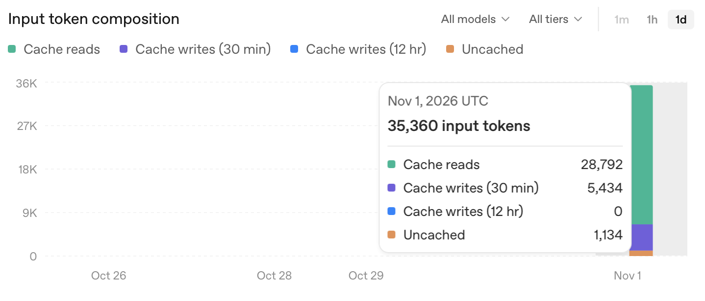

# Milestone 1: bounded source investigation

## Question and protocol

Can one model follow source evidence, choose useful repository actions, and produce a reviewable security hypothesis within enforced execution limits?

The evaluation uses a small inventory fixture with one seeded cross-tenant quantity disclosure and a separate tenant-scoped read path. Both endpoints depend on a trusted authenticated principal. A reviewer checks the outputs against the [evaluator's answer key](../../evaluation/README.md), which is outside the investigating model's accessible source subtree.

The initial protocol was one targeted investigation, then one open exploration, each with a fresh conversation and the same source snapshot, implementation revision, model, and limits. A final-reference failure in the targeted run led to a focused protocol fix and a second pair of runs. Both pairs, including the failed delivery, are retained below. No answer-key material, expected endpoint name, or prescribed file sequence was included in the requests. The fixture, targeted question, security instructions, and review criteria were not tuned to identify the expected issue; the fix changed how application-owned snapshot identity is attached to citations.

| Setting | Value |
| --- | --- |
| Source commit, all four evaluation runs | `76cdccf307e7a020dc91be21ae53b6c8a1cace2a` |
| Initial investigator commit | `76cdccf307e7a020dc91be21ae53b6c8a1cace2a` |
| Investigator commit after identity fix | `412e2e6ec8d2ae7f7d751b38d5dc34641fceca62` |
| Source subtree | `fixtures/inventory-api` |
| Provider/model | OpenAI / `gpt-6-luna` |
| Reasoning | `medium` |
| Final candidate maximum | 3 |
| Model / inspection call limits | 12 / 40 |
| Elapsed-time limit | 180,000 ms |
| Per-response / cumulative tool-output limits | 16,384 / 262,144 bytes |
| Runtime / package manager | Node.js 24.7.0 / npm 11.19.1 |
| Dependencies | Versions in the commit's `package-lock.json` |

The targeted question is:

> Investigate whether authenticated users can read inventory belonging to another tenant. Follow relevant code relationships and consider protective controls.

Open exploration omits the question, using the application's generic request to explore the repository for credible security risks. Requests use the same policy instructions and available tools. The model can finish with zero to three hypotheses; it is not required to fill the maximum.

## Review criteria

- The final hypothesis identifies the availability endpoint's unscoped item lookup and the quantity disclosure it permits when another tenant's item ID is known.
- Source evidence follows the handler, query, and repository relationship, with references resolving to lines actually returned during that run.
- The tenant-scoped detail path is considered as a protective control and is not accused of the same missing tenant constraint without supporting evidence.
- At least one follow-up action responds to earlier source evidence, rather than following an application-prescribed file sequence.
- The report states uncertainties and the absence of runtime verification, and execution stays within the configured limits.

A completed run is an execution outcome, not an automatic quality pass. A missed seeded issue or unsupported accusation against the protected path fails this small demonstration and must be recorded. Additional hypotheses require individual review; they are not automatically false positives because they are absent from the seed list. Review is manual, rather than matching a required sentence or tool-call order.

## Results

All evaluation runs used content identity `8107b80d6ea834ab142df53f56ec7157ce4149e7b12544cc4d2b8508e008d8d0`, with five included files and no skipped entries. They ran on November 1, 2026 (UTC). The full commit in each run's `request` identifies its target source; investigator revisions are recorded separately above.

| Run | Execution outcome | Accepted final hypotheses | Model / inspection calls | Input / output tokens | Tool-response bytes | Elapsed seconds |
| --- | --- | --: | --- | --- | --: | --: |
| Initial targeted | Incomplete: invalid final reference | 0; one provisional checkpoint retained | 9 / 8 | 37,244 / 2,491 | 7,129 | 36.10 |
| Initial open | Completed | 1 | 7 / 6 | 28,066 / 1,786 | 6,699 | 27.01 |
| Targeted after fix | Completed | 1 | 9 / 8 | 35,708 / 1,417 | 7,264 | 19.55 |
| Open after fix | Completed | 1 | 8 / 7 | 32,110 / 1,624 | 7,080 | 20.66 |

All reported token totals are complete. No run exhausted a configured limit; the largest individual tool-response envelope was 2,072 bytes. The initial targeted run failed validation rather than budget control. Its final hypothesis was rejected as a whole, so it has no accepted final assessment even though a valid earlier checkpoint identified the seed.

### Manual quality review

This is the implementation assistant's source-and-trace review against the evaluator key, not independent human review or an automated semantic grading result. The archived evidence is available for a separate reviewer to challenge these assessments.

| Criterion | Initial targeted | Initial open | Targeted after fix | Open after fix |
| --- | --- | --- | --- | --- |
| Seeded issue identified in the model's analysis | Yes, including retained checkpoint | Yes | Yes | Yes |
| Final evidence accepted | No: one mistyped snapshot ID | Yes | Yes | Yes |
| Protected detail path treated appropriately | Recognized as tenant-scoped | Recognized as tenant-scoped | Explicit protective-control reference | Compared with tenant-scoped repository/query behavior |
| Evidence-driven follow-up visible | Yes | Yes | Yes | Yes |
| Unperformed runtime verification acknowledged | Yes | Yes | Yes | Yes |
| End-to-end demonstration passes | No | Yes | Yes | Yes |

The final hypotheses in the three completed runs follow the handler → query → repository relationship and identify the quantity disclosure for a known foreign item ID. None reports the protected item-detail path as having the same missing tenant check. No additional vulnerability hypotheses were submitted. This supports “no observed false-positive accusation against this protected case,” not a general false-positive rate or a complete assessment of the fixture. The seeded issue was not missed in the model analyses, but the initial targeted run did fail to deliver a valid final result.

The repeated targeted run explicitly records the scoped detail query as a protective control. The open run describes the contrast in prose but leaves `contradictoryEvidence` empty; the secure sibling path is not itself a contradiction of the availability issue. A reporting refinement could distinguish protective context from evidence that actually refutes a claim. The open run's claim also mentions returning the item ID, which the caller already supplies: the meaningful new disclosure is quantity, not demonstrated ID discovery. Words such as “high-confidence” are uncalibrated model judgments.

### Failure and application-boundary fix

The initial targeted run copied the correct snapshot ID into its checkpoint citations. At `event-17`, its final submission shortened the ID on the `src/model.ts:1–10` reference. Application validation rejected that submission and retained the prior checkpoint. The source was unchanged; this was an identifier reproduction failure, not evidence of an undiscovered security control or a different vulnerability.

The fix in `412e2e6` removes `snapshotId` from model-facing evidence arguments. The model chooses a previously observed tool-call ID, path, and line range. The adapter then attaches the snapshot identity from trusted run context. Persisted references still contain the full ID and pass the same application and reporting checks. A response that supplies its own snapshot field is rejected by the strict model-facing schema; no unknown fields or historical errors are silently repaired.

The regression test covers supporting evidence, contradictory evidence, and provisional checkpoints. No provider switch, weaker evidence checks, automatic retry, fixture change, or vulnerability-specific prompt hint was needed. The repeated pair used fresh conversations; it is a separate experiment, not a continuation that corrected the rejected final answer in place.

### Model-directed behavior

In the repeated targeted run, `tool-4` reads the query. The next model action, `event-9`, chooses to inspect the repository to determine whether the ID lookup enforces ownership. After inspecting the model and README, `event-15` selects a `getAvailability` search to check call sites. Both follow-ups refer to earlier evidence through application-assigned tool IDs.

The repeated open run chooses a different start: list files → README → HTTP handlers → query → repository → model → call-site search. Its `event-9` follows the query's unused principal into repository semantics. Application code did not prescribe either sequence or select which security hypothesis to prioritize.

The targeted runs also made a case-sensitive `inventory` search that returned no matches. The initial targeted run repeated a listing after that search. These are recorded efficiency limitations. Differences in call count, tokens, or duration between these few runs do not establish that either investigation mode or the identity fix is faster; context size, cache state, model choices, and provider conditions were not controlled as a performance benchmark.

## Retained artifacts

Each directory contains the original `run.json`, rendered `report.md`, manifest, and exact `source/` snapshot. Source hashes and report regeneration were checked after copying. Archived runs are excluded from formatting so line references and content identities remain stable.

| Run | Report | Full trace and structured result |
| --- | --- | --- |
| Earlier pilot | [Report](./runs/milestone-1/pilot/report.md) | [Run JSON](./runs/milestone-1/pilot/run.json) |
| Initial targeted, rejected final | [Incomplete report](./runs/milestone-1/baseline-targeted/report.md) | [Run JSON, including rejected submission](./runs/milestone-1/baseline-targeted/run.json) |
| Initial open | [Report](./runs/milestone-1/baseline-open/report.md) | [Run JSON](./runs/milestone-1/baseline-open/run.json) |
| Targeted after fix | [Report](./runs/milestone-1/targeted/report.md) | [Run JSON](./runs/milestone-1/targeted/run.json) |
| Open after fix | [Report](./runs/milestone-1/open/report.md) | [Run JSON](./runs/milestone-1/open/run.json) |

These artifacts contain only the controlled target's source and nonsecret investigation metadata. The answer key, account credentials, local absolute paths, and SDK reasoning payloads are not included in the investigation artifacts.

## Repeat the demonstration

To reproduce the post-fix implementation, use investigator revision `412e2e6ec8d2ae7f7d751b38d5dc34641fceca62` and its lockfile. Model responses can vary even with the recorded configuration; this reproduces the experimental setup, not identical model output.

```sh
npm ci
npm run typecheck
npm test

# Targeted: requires OPENAI_API_KEY in the environment or local .env.
npm run investigate -- \
  --repo . \
  --commit 76cdccf307e7a020dc91be21ae53b6c8a1cace2a \
  --subtree fixtures/inventory-api \
  --question 'Investigate whether authenticated users can read inventory belonging to another tenant. Follow relevant code relationships and consider protective controls.'

# Open: fresh run with the same defaults and no question.
npm run investigate -- \
  --repo . \
  --commit 76cdccf307e7a020dc91be21ae53b6c8a1cace2a \
  --subtree fixtures/inventory-api
```

Review the generated hypotheses and trace against the criteria above, recording misses and unsupported accusations. The source copy is prepared from the selected commit, not current local edits. The defaults in the recorded investigator revision match the protocol table.

On a checkout containing these archived artifacts, regenerate a report without credentials or model requests:

```sh
npm run report -- --run docs/experiments/runs/milestone-1/targeted/run.json
```

The deterministic test suite validates fixture behavior, repository boundaries, pagination and byte limits, cancellation, evidence handling, and report rendering. It uses scripted model functions and mocked provider responses. Live output quality is assessed separately by the manual review above; passing those tests alone does not show that the live model found the seed.

## Architectural lessons and limits

LangGraph contributes an explicit action-choice/execution cycle, graph state, and conditional routing to termination. Application code owns repository boundaries, counters, deadlines, candidate checkpoints, evidence validation, and completion rules. The model chooses code relationships and hypotheses. The snapshot-ID failure illustrates why opaque application facts should be supplied by code rather than reproduced by a model.

A plain loop could implement this first milestone. LangGraph is used deliberately to learn graph orchestration and establish a small foundation for later verification phases. Durable checkpointing, parallel agents, provider routing, and scanner integration are not exercised by this experiment and would not explain the observed result.

The fixture's deterministic tests already establish the seeded behavior and are preferable for regression checking that known invariant. The model experiment demonstrates evidence-driven exploration rather than an accuracy or capability advantage over deterministic tools.

After the focused fix, both repeated modes meet the milestone's demonstration criteria. The retained baseline failure remains part of that conclusion. The current evidence is limited to one deliberately small fixture with one known positive issue and one protected read path. It does not establish coverage of real repositories, calibrated confidence, typical cost or latency, resistance to prompt injection, runtime exploitability, or reliable behavior across repeated trials. Only one post-fix run per mode was performed; no statistical detection or false-positive rate is reported.

Useful follow-up experiments are a larger authorized repository, more diverse and fully protected fixtures, and explicit verification of selected hypotheses. Those require new experiment scope rather than being implied by milestone 1 completion.

## Earlier pilot: dashboard observation

Before the evaluation runs, a [targeted pilot](./runs/milestone-1/pilot/report.md) used the same model and limits against source commit `31b46e715e2d414f0b79fe2c12f208db914950db`. It completed in approximately 28.85 seconds with 9 model calls, 8 inspection calls, 35,360 input tokens, and 1,611 output tokens. Its investigation code was the then-uncommitted Step 4 implementation preceding `a9c91e0`; its report was rendered later without another model call. The later source revision includes Markdown formatting changes; the pilot is not substituted for any run in the two evaluation pairs.



The screenshot was captured on November 1, 2026 (UTC) after the pilot and before the evaluation runs. The account owner reported no other API activity in the displayed period at capture time. Its total exactly matches the pilot's recorded input usage:

| Input category           | Tokens |
| ------------------------ | -----: |
| Cache reads              | 28,792 |
| Cache writes, 30 minutes |  5,434 |
| Cache writes, 12 hours   |      0 |
| Uncached                 |  1,134 |
| Total                    | 35,360 |

The screenshot is account-level supporting evidence associated with that pilot, not per-call cache telemetry, a measurement for the later evaluation pairs, or a general cache-performance claim. The implementation currently retains aggregate input/output tokens but discards the response's cache breakdown. The displayed cache-read ratio is approximately 81.4%; reads divided by writes by token volume are approximately 5.3. No monetary-cost estimate is inferred from this image.
