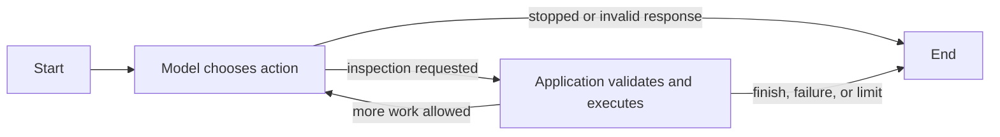

# Model-directed exploration

Step 4 adds a local CLI and one-model exploration loop. It produces `run.json`, not the rendered Markdown report planned for Step 5.

## Responsibilities

`src/investigation/contract.ts` defines candidate, evidence, action, configuration, trace, and result shapes. Zod supplies runtime validation; TypeScript types alone cannot validate model-generated JSON.

`src/investigation/session.ts` owns application policy: counters, deadline, candidate checkpoints, evidence integrity, and termination. It has no LangGraph or OpenAI SDK dependency. Its model-call function is a small testing seam, not a provider routing system.

`src/orchestration/explore.ts` connects application behavior using LangGraph's `StateSchema`, `StateGraph`, and conditional edges:



The structured run result and pending action are graph state. The session owns the evolving in-memory application state; there are no checkpoints, durable stores, parallel branches, or automatic retries. The graph coordinates the cycle without choosing a file sequence or ranking security hypotheses itself.

`src/models/openai.ts` owns the SDK-specific conversation. The Responses API receives function schemas for `list_files`, `search_text`, `read_lines`, and `finish`, with one call per response. Reasoning items are carried forward in the SDK conversation using encrypted content; they are not requested as readable reasoning or saved in the run trace. API response storage is disabled. Only source returned through inspection and the investigation configuration are sent to the model, not the evaluator directory or local credentials.

## Run locally

Install dependencies with `npm ci`. Supply `OPENAI_API_KEY` through the process environment or a local `.env`. Environment values take precedence. Do not place credentials in the source target.

For the controlled fixture, use a full commit ID containing the fixture:

```sh
npm run investigate -- \
  --repo . \
  --commit <full-commit-id> \
  --subtree fixtures/inventory-api \
  --question 'Can authenticated users read inventory belonging to another tenant?'
```

Omit `--question` for open exploration. Defaults are `gpt-6-luna`, medium reasoning, a maximum of three final candidates, 12 model calls, 40 inspection calls, and 180 seconds. Flags `--model`, `--reasoning`, `--max-candidates`, `--model-calls`, `--tool-calls`, and `--elapsed-ms` adjust those values. Final candidate limits are 1–10; provisional lists may contain up to 20 candidates.

The default output parent is `priv/runs`. Override it with `--output`. Each run has a unique directory with `source/`, `manifest.json`, and `run.json`. The model can inspect only `source/`. Result artifacts contain inspected source excerpts; choose their storage accordingly. SIGINT requests cancellation and saves an incomplete result. An incomplete run exits with status 1.

## Decisions and evidence

Each proposed action includes a short rationale and `basedOnToolCallIds` for relevant earlier observations. The application assigns IDs such as `tool-1`; these differ from the provider's function call IDs. The trace records the action, actual arguments and result, timing, outcome, and observed model identifier.

An inspection action can include a complete provisional candidate replacement. `checkpoint: null` keeps the previous list, and `checkpoint: []` clears it. This allows candidates to be added, reprioritized, merged, or discarded. Replacement evidence must already have been returned by an earlier call. Final ordering is the model's priority judgment, not an application score.

Candidate references must use the current snapshot, a known inspection call, and source lines actually returned by that call. A directory listing is not source evidence. At finish, the application validates counts and references, then rechecks the cited snapshot files for changes. These integrity checks do not establish that the model's security interpretation is correct.

## Limits and failure behavior

The application counts dispatched model attempts and inspection invocations, including failed or denied ones. SDK retries are disabled. Invalid inspection arguments return bounded errors for the model to reconsider. Invalid action structure, unknown causal IDs, or invalid candidate evidence terminate the run without a repair loop. A final `finish` is a control action, not an inspection invocation.

Each tool-response envelope, including its application ID, must fit the per-call and cumulative byte allowances. Model responses are additionally bounded to 8,192 output tokens per request. Exact token spend is measured when returned by the provider, not enforced as a monetary budget. Usage is marked partial after a failed or aborted request when its usage cannot be recovered.

Deadlines use a monotonic clock and abort in-flight requests. The application also returns promptly when a test model ignores cancellation. Inspection checks the abort signal at file operations; this is not preemptive isolation of CPU work or another process. An aborted provider request may still be billed.

Budget exhaustion, snapshot changes, model failures, invalid responses, and user cancellation preserve available trace and provisional candidates without another model call. A completed empty list differs from an incomplete run with `finalCandidates: null`. Neither establishes that the repository is secure.

Run `npm run typecheck` and `npm test` for deterministic checks. These include a scripted model and mocked HTTP responses; they do not spend API tokens or prove live-model investigation quality. Live fixture evaluation remains a separate experiment.

## API references

- [LangGraph JavaScript quickstart](https://docs.langchain.com/oss/javascript/langgraph/quickstart)
- [OpenAI function calling](https://developers.openai.com/api/docs/guides/function-calling)
- [GPT-6 Luna](https://developers.openai.com/api/docs/models/gpt-6-luna)
